# Demostración: 5 errores introducidos a propósito y cómo las pruebas los detectan

**Objetivo:** demostrar que las pruebas de compatibilidad (ISO/IEC 25010) **detectan errores reales**.
Se introdujo a propósito un error en el código, se ejecutó la prueba correspondiente (**falla**), se
corrigió el código y se ejecutó la misma prueba otra vez (**pasa**).

**Fecha:** 2026-11-01 · **Reproducir:** `python tests/demostracion/demostrar_errores.py` (o solo uno: `... 3`)

| # | Área (ISO 25010) | Error introducido | Prueba que lo detecta | Con el error | Corregido |
|---|---|---|---|---|---|
| 1 | Interoperabilidad · Meta WhatsApp | Un bloqueo de Meta se muestra como error del usuario | `test_cliente_whatsapp.py` | ❌ falla | ✅ pasa |
| 2 | Interoperabilidad · Amazon SES | El enlace de invitación se arma sin codificar el correo | `test_correo_ses.py` | ❌ falla | ✅ pasa |
| 3 | Co-existencia · Base de datos | Cada servicio puede abrir demasiadas conexiones | `test_infraestructura_compartida.py` | ❌ falla | ✅ pasa |
| 4 | Co-existencia · Permisos AWS | WhatsApp recibe permisos que no necesita | `test_infraestructura_compartida.py` | ❌ falla | ✅ pasa |
| 5 | Navegadores · Portal | El perfil queda abierto sin iniciar sesión | Playwright `portal.spec.ts` (Chrome) | ❌ falla | ✅ pasa |

Cada error tiene 4 capturas: **(1) código con el error → (2) la prueba falla → (3) código corregido →
(4) la prueba pasa**. El error 5 tiene además **(5) y (6): el programa en el navegador** antes y después.

> **Seguridad de la demostración:** el script guarda cada archivo original byte a byte y lo restaura
> siempre (aunque algo falle). Nada se desplegó a AWS. Al terminar se verificó con SHA-256 que los 5
> archivos quedaron idénticos a como estaban.

---

## Error 1 · Interoperabilidad · Un bloqueo de Meta se muestra como error del usuario

- **Archivo:** `backend/servicio-comunicaciones/app/infrastructure/whatsapp_client.py`, línea 22
- **Cambio:** `_ERRORES_DE_ACCESO = {10, 200, 368, 131031}` → `{10, 368, 131031}` (se quitó el código 200)
- **Impacto:** si Meta bloquea la app ("API access blocked", código 200), el ERP responde **400 "solicitud
  inválida"**: el usuario cree que hizo algo mal y nadie se entera de que hay que revisar la app en Meta.
  Es exactamente el incidente real de WhatsApp de octubre.
- **Cómo lo detecta la prueba:** el caso `200-api-bloqueada` simula la respuesta de Meta y espera
  `ServicioNoDisponible` (503); recibe `SolicitudInvalida: API access blocked.`. El caso `10-sin-permiso`
  sigue pasando: el error afecta solo al código 200.

| | Código | Resultado de la prueba |
|---|---|---|
| **Antes** | 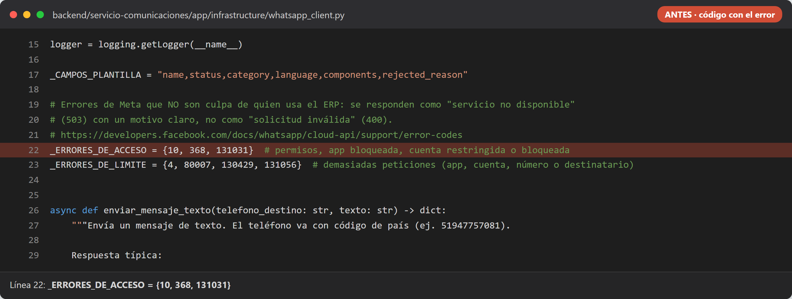 | 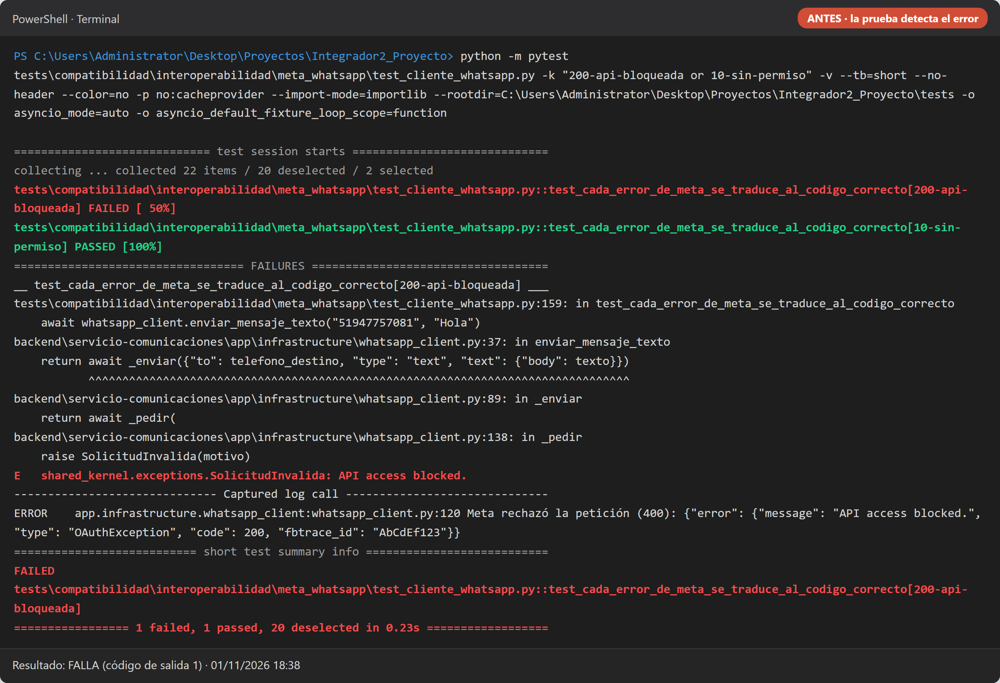 |
| **Después** | 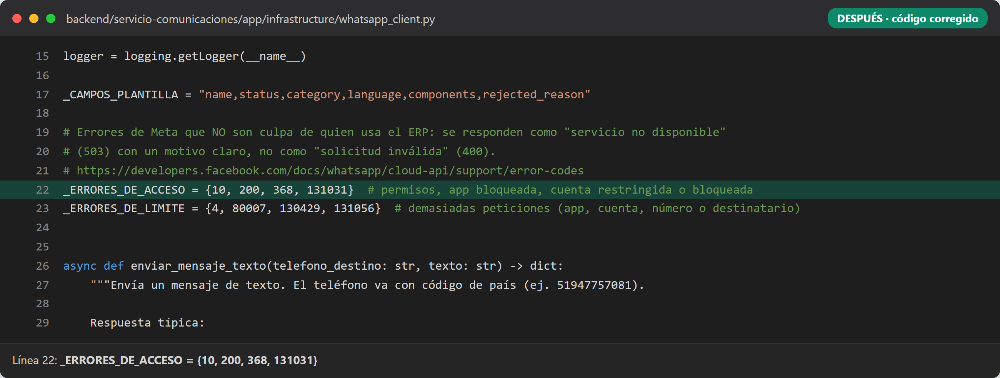 | 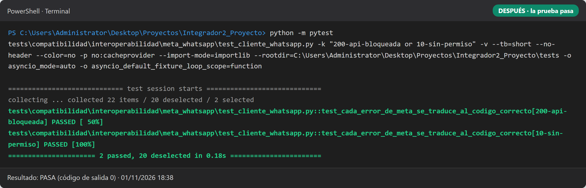 |

## Error 2 · Interoperabilidad · El enlace de invitación se arma sin codificar el correo

- **Archivo:** `backend/servicio-postulantes/app/infrastructure/correo.py`, línea 82
- **Cambio:** `urlencode({"invitacion": token_invitacion, "email": email})` → `f"invitacion={token_invitacion}&email={email}"`
- **Impacto:** un correo con "+" (ej. `ana+postula@correo.com`, común en Gmail) llega al portal como
  `ana postula@correo.com`: el "+" se convierte en espacio y el postulante no puede crear su cuenta con el
  enlace que recibió por correo.
- **Cómo lo detecta la prueba:** lee el enlace del correo como lo haría el navegador y compara:
  obtiene `'ana postula@correo.com'` en vez de `'ana+postula@correo.com'`.

| | Código | Resultado de la prueba |
|---|---|---|
| **Antes** | 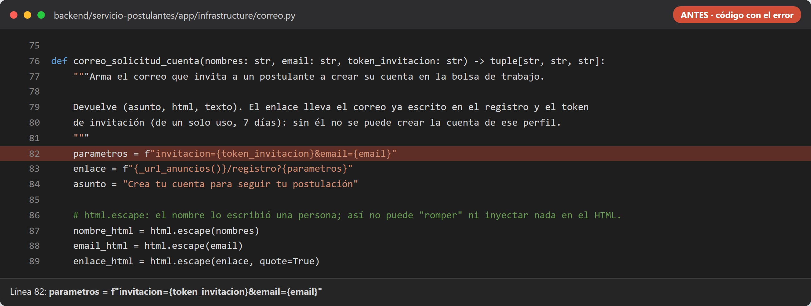 | 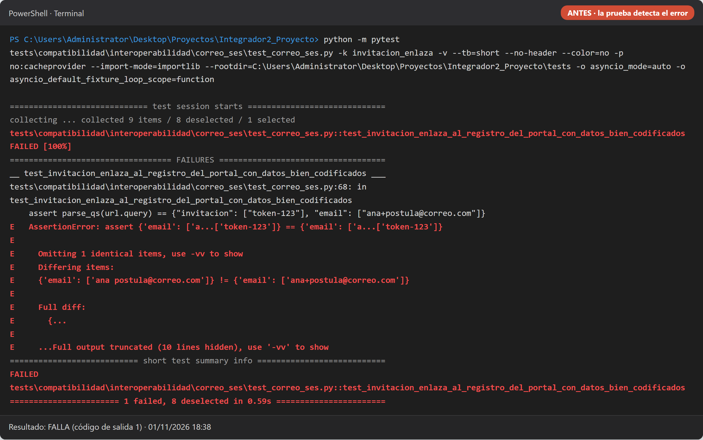 |
| **Después** | 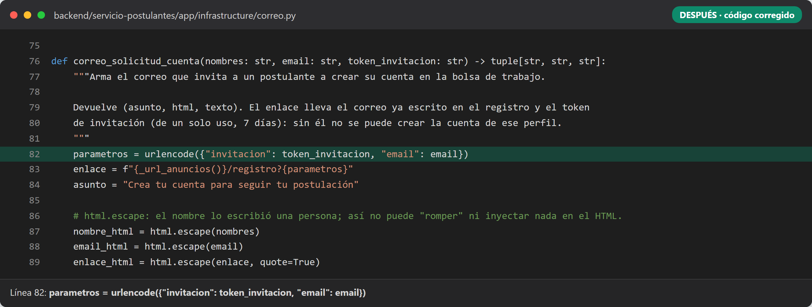 | 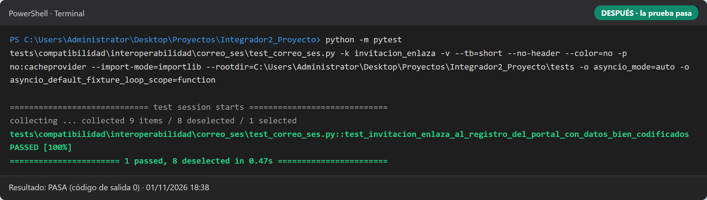 |

## Error 3 · Co-existencia · Cada servicio puede abrir demasiadas conexiones a la base

- **Archivo:** `backend/libs/shared/shared_kernel/database.py`, línea 46
- **Cambio:** `CONEXIONES_EXTRA = 2` → `CONEXIONES_EXTRA = 20`
- **Impacto:** los 5 servicios comparten una base RDS `db.t4g.micro` (máximo 112 conexiones). Con 20
  extra cada uno, juntos pueden abrir 5 × (3 + 20) = **115**: en un pico, un servicio deja sin conexiones
  a los demás (falla la co-existencia).
- **Cómo lo detecta la prueba:** suma los pools de los 5 servicios y exige que no pasen del 50 % del
  máximo de RDS (56).

| | Código | Resultado de la prueba |
|---|---|---|
| **Antes** | 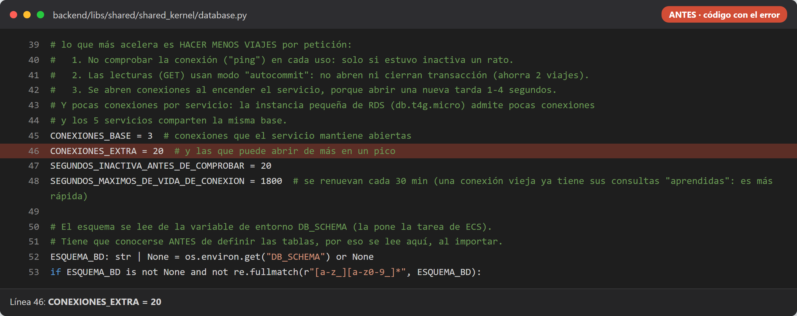 | 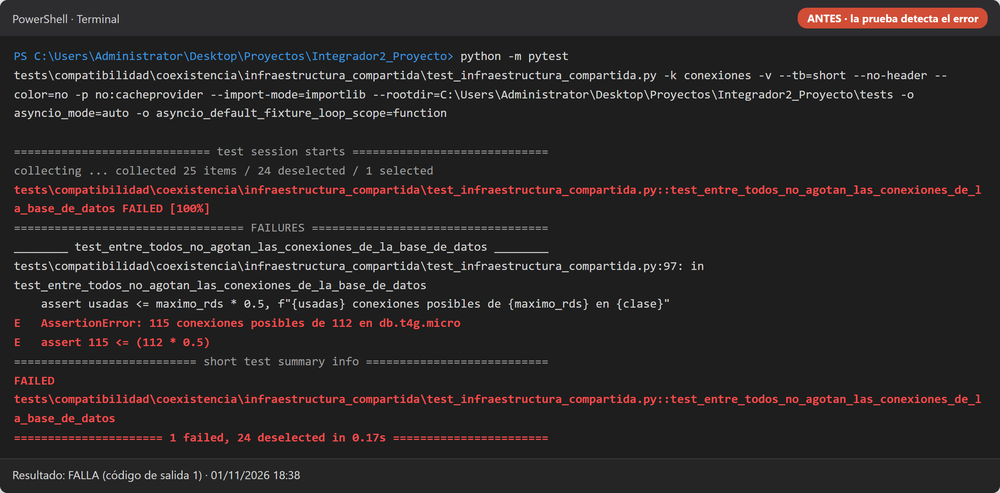 |
| **Después** | 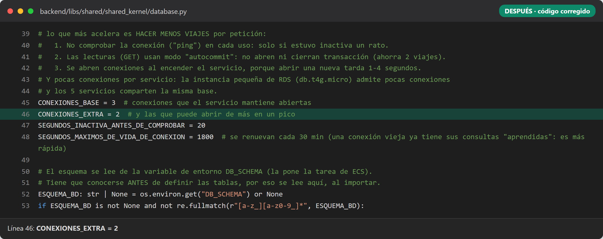 | 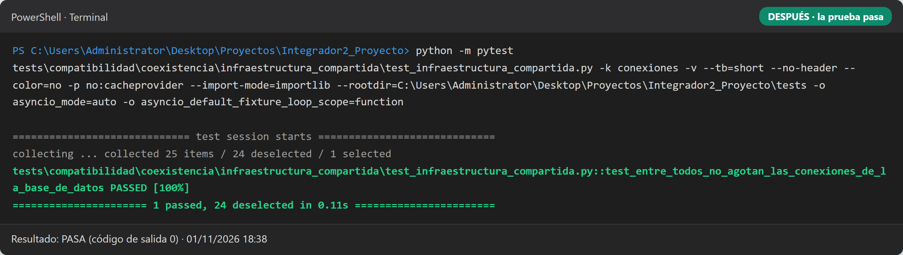 |

## Error 4 · Co-existencia · El servicio de WhatsApp recibe permisos que no necesita

- **Archivo:** `infra/aws/app.yaml` (infraestructura como código), línea 424
- **Cambio:** el rol de la tarea de `servicio-comunicaciones` pasa de `rol-sin-permisos` a `rol-postulantes`
- **Impacto:** el servicio de WhatsApp podría leer y borrar los CV y DNI de S3 y enviar correos. Si ese
  servicio se compromete, expone los documentos de todos los postulantes (rompe el aislamiento entre servicios).
- **Cómo lo detecta la prueba:** lee la plantilla de CloudFormation y exige mínimo privilegio: solo
  `servicio-postulantes` puede tener permisos de AWS mientras corre.

| | Código | Resultado de la prueba |
|---|---|---|
| **Antes** | 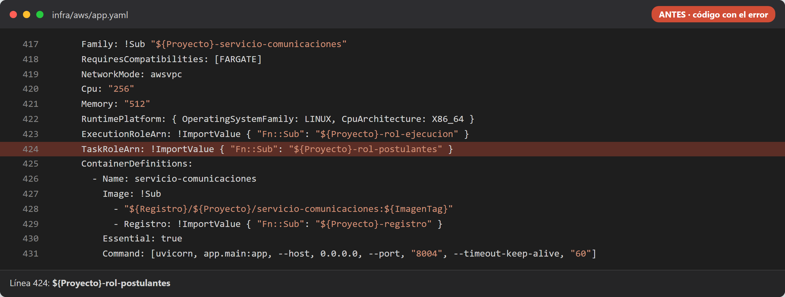 | 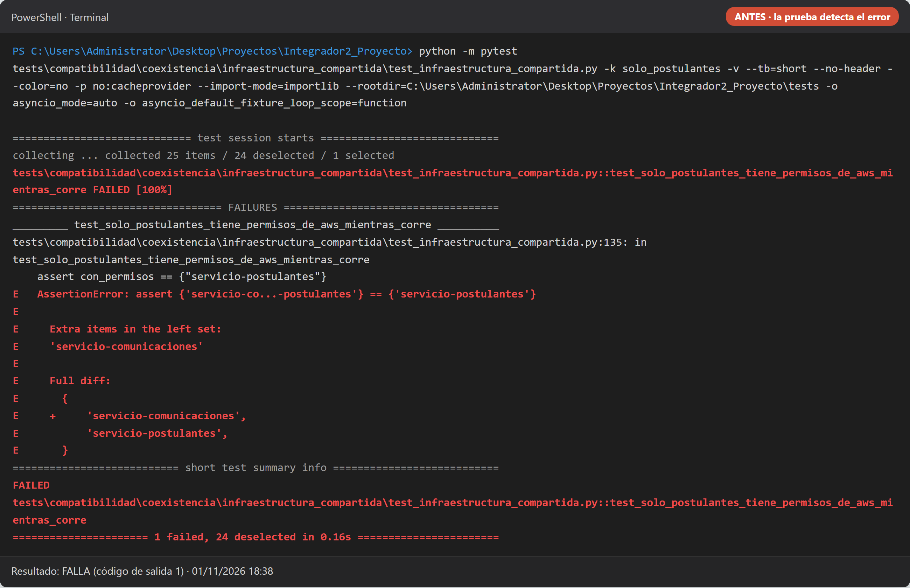 |
| **Después** | 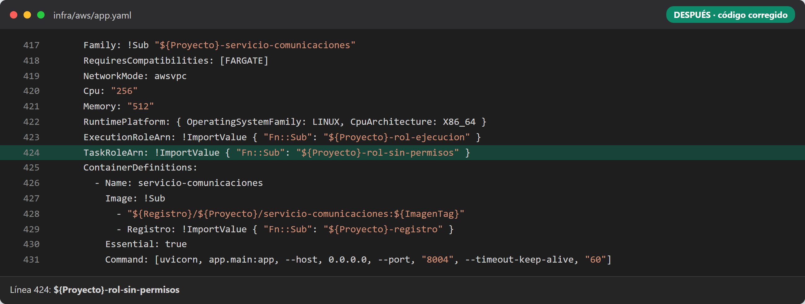 | 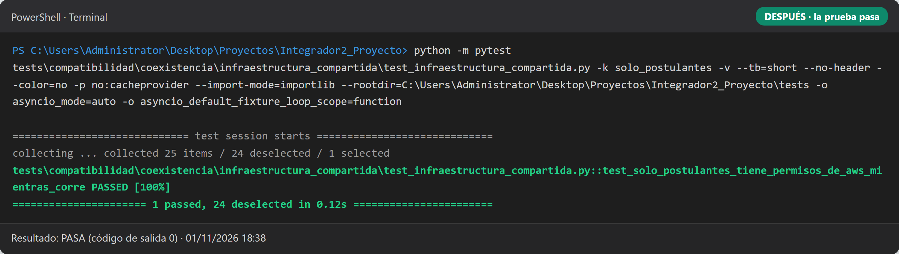 |

## Error 5 · Navegadores · El perfil del postulante queda abierto sin iniciar sesión

- **Archivo:** `frontend/ANUNCIOS/middleware.ts`, línea 22
- **Cambio:** `pathname.startsWith('/perfil')` → `pathname.startsWith('/perfiles')` (un error de tipeo)
- **Impacto:** cualquiera puede abrir `/perfil` sin iniciar sesión, en cualquier navegador.
- **Cómo lo detecta la prueba:** Playwright abre `/perfil` sin sesión en Chrome y espera ser llevado a
  `/login?siguiente=...`; con el error, la página se queda en `http://localhost:3101/perfil`.
- **El programa:** se ejecutó el portal real (Next.js) en la PC y se capturó el navegador. Con el error,
  `/perfil` abre sin sesión; corregido, el navegador termina en `/login?siguiente=%2Fperfil`.

| | Código | Resultado de la prueba |
|---|---|---|
| **Antes** | 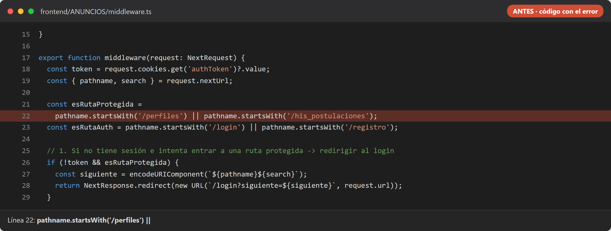 | 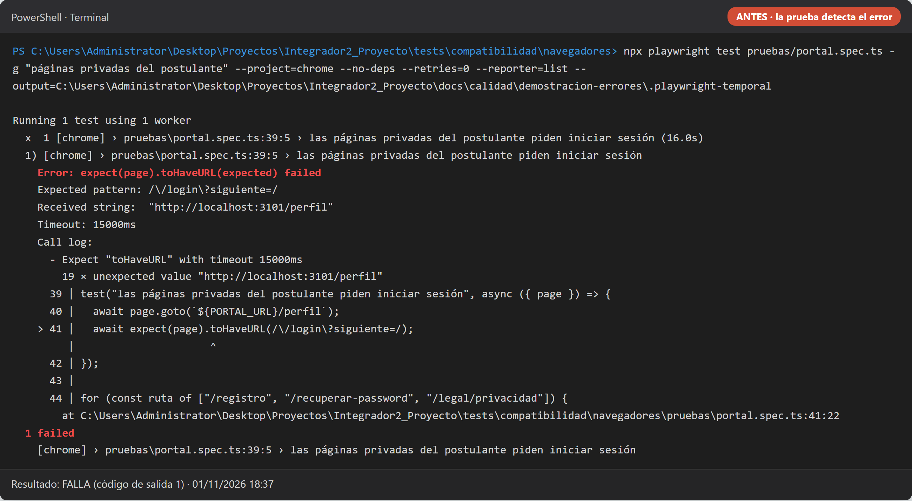 |
| **Después** | 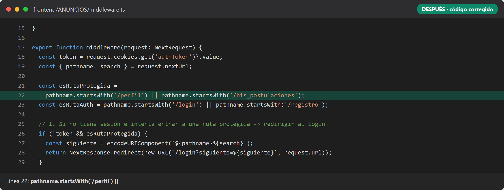 | 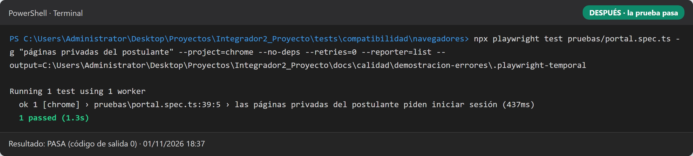 |

| El programa en el navegador · **antes** | El programa en el navegador · **después** |
|---|---|
| 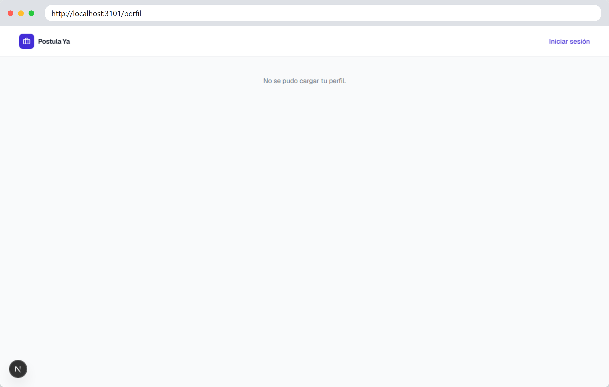 | 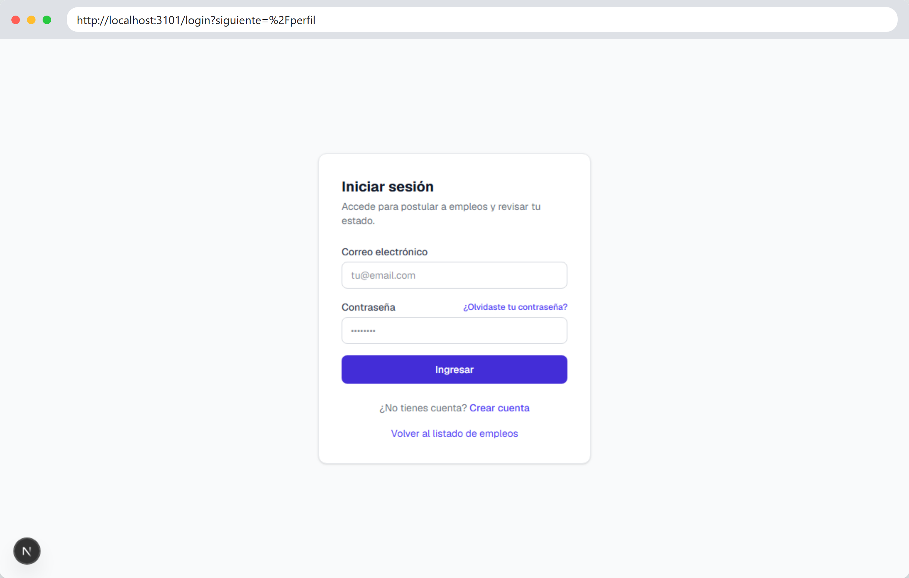 |

---

## Cómo explicarlo (guion corto por error)

1. **Qué hace el sistema** cuando funciona bien (una frase).
2. **El error introducido:** mostrar la captura 1 (línea marcada en rojo).
3. **La prueba lo detecta:** captura 2, señalar la línea en rojo (`FAILED` / `Error:`) y el valor
   esperado frente al recibido.
4. **La corrección:** captura 3 (línea en verde).
5. **La prueba pasa:** captura 4 (`passed` en verde). En el error 5, cerrar con las capturas del navegador.
6. **Conclusión:** si alguien vuelve a introducir este error, el CI (`ci-compatibilidad.yml`) lo bloquea
   antes de llegar a producción.

## Archivos

- `errorN-1-codigo-antes.png` · `errorN-2-resultado-antes.png` · `errorN-3-codigo-despues.png` · `errorN-4-resultado-despues.png`
- `error5-5-programa-antes.png` · `error5-6-programa-despues.png`
- `errorN-p1…p4-*.png`: las mismas capturas en versión compacta para diapositivas (3 líneas de código alrededor del cambio y solo las líneas clave de la prueba); se usan en `docs/calidad/TalentERP-pruebas-compatibilidad.pptx`
- `resultados.json`: resultado de cada paso (falla antes / pasa después, línea, URLs del navegador)
- Script: `tests/demostracion/demostrar_errores.py` (+ `capturar.cjs` y `marco_navegador.html`)
